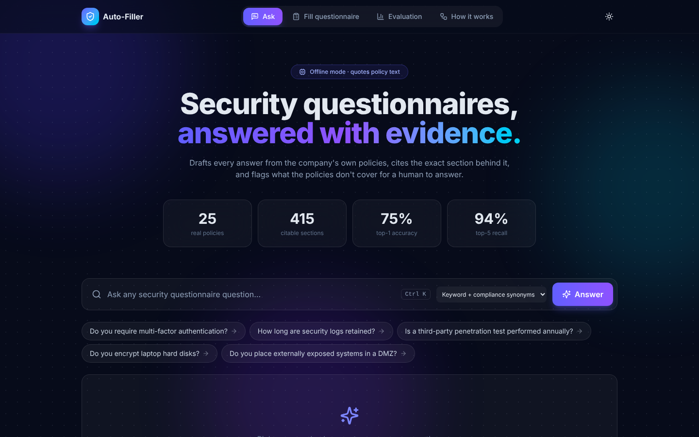
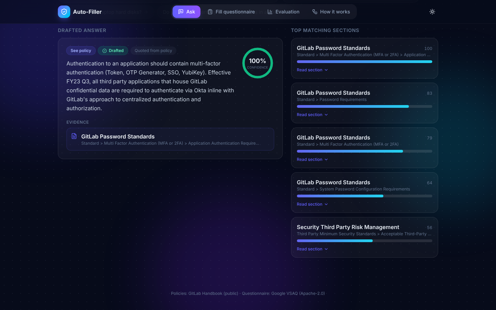
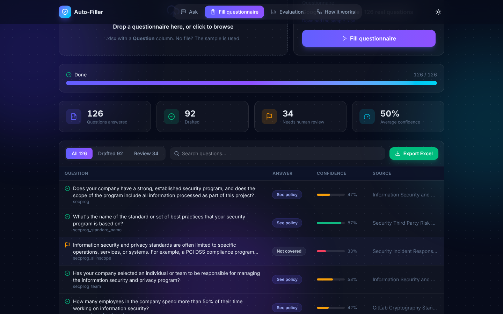
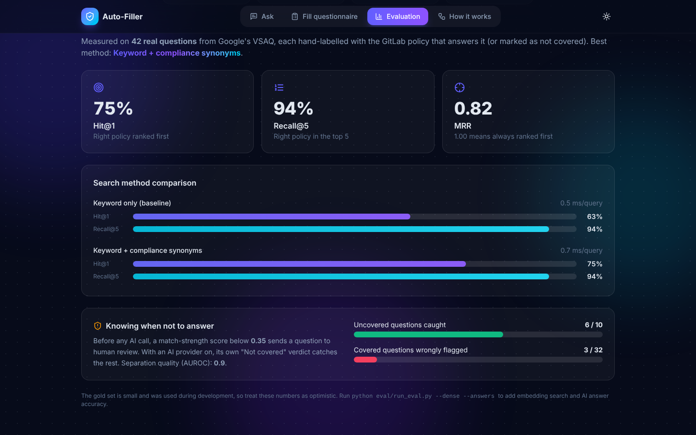

# Security Questionnaire Auto-Filler

Vendors spend days answering 100-300 question security questionnaires (SIG, CAIQ, VSAQ) before a
customer will sign. The answers already exist, scattered across the company's policies. This tool reads
the policies, drafts every answer with a citation to the exact policy section, and flags the questions
the policies don't cover so a human answers those instead of an AI guessing.

It runs on **real, public data only**: GitLab's published security policies as the company's policy
library, and Google's open-source VSAQ as the incoming questionnaire. See [SOURCES.md](SOURCES.md).





| Fill a whole questionnaire | Evaluation |
|---|---|
|  |  |

## Results

Measured on 42 real VSAQ questions, hand-labelled against GitLab's policies (`python eval/run_eval.py`):

| Retriever | Hit@1 | Recall@5 | MRR | Latency |
|---|---|---|---|---|
| BM25 baseline | 62% | 94% | 0.73 | <1 ms |
| BM25 + compliance query expansion | **75%** | **94%** | **0.82** | <1 ms |

Query expansion maps questionnaire vocabulary to policy vocabulary ("malware" to "endpoint detection
and response", "researchers report vulnerabilities" to "bug bounty / HackerOne"). It lifts top-1
accuracy by 13 points with no model and no extra latency.

**Knowing when not to answer.** A match-strength score separates covered from uncovered questions with
AUROC 0.90. At the default threshold it flags 6 of 10 uncovered questions before any LLM call while
wrongly flagging 3 of 32 covered ones; with an LLM configured, its own "Not covered" verdict catches
the rest.

Caveat: the gold set is small and was used while developing, so these numbers are optimistic. A
held-out set is the next step.

## How it works

```
policies (Markdown) -> ingest: strip markup, split by heading, keep title/section/URL -> 415 chunks
question -> retrieve: BM25 + query expansion (optional: dense embeddings, fused with RRF)
         -> gate: weak match? -> "Needs review"
         -> draft: an LLM answers ONLY from the top 5 excerpts, returns JSON with citations + confidence
         -> low confidence / no citation / "Not covered" -> "Needs review"
-> filled Excel: answer, explanation, confidence, status, clickable citations
```

## Choosing the LLM (free options included)

Copy `.env.example` to `.env` and fill in any keys you have. The first available provider is used, and if
a call fails (for example a free-tier rate limit), the next one takes over:

| Priority | Provider | Cost | Setup |
|---|---|---|---|
| 1 | Google Gemini | Free tier | `GEMINI_API_KEY` from https://aistudio.google.com/apikey |
| 2 | Groq (Llama 3.3 70B) | Free tier | `GROQ_API_KEY` from https://console.groq.com/keys |
| 3 | Ollama (local) | Free | Install https://ollama.com, run `ollama pull llama3.2` |
| 4 | Anthropic Claude | Paid | `ANTHROPIC_API_KEY` |

With none configured, the tool still runs end to end: it quotes the most relevant policy sentences
instead of writing an answer. The sidebar shows which providers are active.

## Run it

```bash
python -m pip install -r requirements.txt
copy .env.example .env                    # optional: add free Gemini/Groq keys; macOS/Linux: cp

python -m uvicorn server:app --port 8000  # then open http://localhost:8000
```

The React frontend is already built (`web/dist`), so that one command serves the whole app. To work on
the frontend with live reload, run the API as above and, in a second terminal (needs Node.js 18+):

```bash
cd web
npm install
npm run dev                               # http://localhost:5173, proxies /api to port 8000
npm run build                             # rebuild web/dist after changes
```

Other entry points:

```bash
python -m autofill.fill data/samples/vsaq_questionnaire.xlsx answers.xlsx   # command line
python eval/run_eval.py --dense --answers                                   # full evaluation
python -m pytest
python -m streamlit run app.py                                              # older Streamlit UI
```

The policy chunks and sample questionnaire are already in `data/`. To re-download the sources from
scratch: `python scripts/fetch_sources.py && python -m autofill.ingest && python scripts/build_sample.py`.

## Layout

| Path | What it does |
|---|---|
| `autofill/ingest.py` | Markdown cleaning, heading-aware chunking, citation URLs |
| `autofill/retrieve.py` | BM25, query expansion, optional dense index, reciprocal rank fusion, match strength |
| `autofill/answer.py` | Grounded answer drafting, abstention, offline fallback |
| `autofill/llm.py` | Gemini → Groq → Ollama → Claude provider chain with automatic fallback |
| `autofill/questionnaire.py` | VSAQ and Excel parsing, filled-Excel export |
| `autofill/fill.py` | Fill a whole questionnaire from the command line |
| `server.py` | FastAPI backend: `/api/ask`, streaming `/api/fill`, `/api/export`; serves the built frontend |
| `web/` | React + Vite + Tailwind + Framer Motion frontend |
| `app.py` | Older Streamlit UI (same engine) |
| `eval/` | Gold set and evaluation script |
| `scripts/` | Source download and sample questionnaire builder |

## Next steps

- Measure dense and hybrid retrieval (`--dense`) and LLM answer accuracy on a larger, held-out gold set
- Reuse previously approved answers as a second retrieval source, the way real answer libraries work
- Accept PDF and Word policies (PyMuPDF / python-docx) alongside Markdown
- Package retrieval as a FastAPI service so other tools can call it
